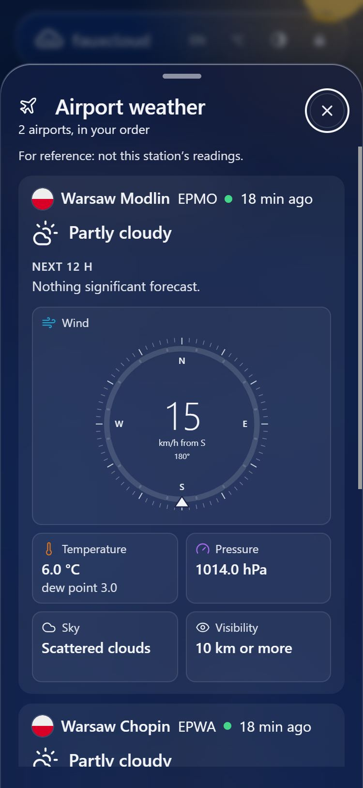

## What you get

Airports publish two things that fauxcloud can fetch:

- **METAR**: the airport's current official report. Wind, temperature, pressure, sky, visibility and the weather in the air right now.
- **TAF**: the airport's forecast for the next hours. fauxcloud shows it in plain words for the next 12 hours.

This is reference data, not your weather. An airport can be many kilometres away, and its weather is not the weather over your garden. fauxcloud always labels it "Not this station's readings". On this page, the console is your weather station's display unit, and a station is fauxcloud's record of that console.

> [!NOTE]
> **Off until you turn it on**
> Nothing is fetched until you switch **Airport weather** on in **Settings** and choose at least one airport.

## Turn it on

1. Open **Settings** (the **Admin** button on the dashboard, a padlock on a phone, or `http://fauxcloud.local/admin`) and sign in.
2. If you have not yet, set your location in **Settings → Location and time**. A location lets fauxcloud find airports for you; a code you type works without one.
3. Under **Home Assistant and online services**, open **Airport weather**.
4. Switch **Airport weather** on.
5. Choose **Find airports near you**, or type an **Airport code** and press **Look up**. Then press **Add** next to the airport.

   **You should see** the airport under **Your airports (up to three)** with its distance, then "No report yet" until the first fetch, about a minute or two later. After that it shows the report's age, the pressure and the wind.

An airport code is the airport's ICAO code: the four-letter code used in aviation, such as `EPWA` or `EPMO`. If it is not in the aviation weather list, the sheet says "No airport ... in the aviation weather list".

Nothing is fetched until the board knows the real time. Until then the sheet shows "Waiting for the clock (internet time)".

### Up to three airports

You can keep up to three. The order matters: the first one is the **Main airport**. It leads on the dashboard and counts most for the pressure reference. Use the arrows beside an airport to move it. **Rename** lets you give an airport your own name; leave it empty to use the name from aviationweather.gov.

**Find airports near you** looks for up to five airports with reports within about 120 km of your location.

## Where you see it

When airport weather is on and an airport is chosen, a small plane button, **Airport weather**, sits at the end of the row of station names, under the dashboard's top bar. It opens the airport view:

- The title names the main airport: "Airport weather · EPWA". The subtitle says "Main airport. Not this station's readings."
- A line of words at the top says what the main airport reports now, such as "Rain at EPWA." or "No current report from EPWA."
- Five tiles: **Wind** (with a dial), **Temperature**, **Pressure**, **Sky** and **Visibility**. If you chose more than one airport, the others appear in each tile's foot.
- A bar under the tiles with each airport's distance and report age, and a link to **All airports**, a sheet with every airport and its **Next 12 h** forecast.

The forecast is worded like the rest of fauxcloud, for example "Rain likely 14:00–18:00" and "Strong gusts possible". "Likely" and "possible" follow the forecast's own certainty. The phenomena it names are thunder, snow, rain, fog and strong gusts. If none is expected it says "Nothing significant forecast."

If the main airport is within 60 km of your location:

- its forecast also shows on the second page of the **Outlook** card under the tiles, tagged with the airport's code;
- its report can add a "reported nearby" line to your [local outlook](outlook.md).

Your own readings always come first.

## How often, and from where

fauxcloud fetches reports every 15 minutes and forecasts once an hour. The data comes from aviationweather.gov, the US weather service's aviation site. It needs no account and no key. **Fetch now** on the sheet asks for the reports at once; it waits a minute between requests.

fauxcloud shows the data and does not store it. The data is not sent on to anyone, and it is not sent to Home Assistant.

> [!NOTE]
> **What leaves your home**
> Each fetch goes to aviationweather.gov over an encrypted connection. The service sees your internet address, the airport codes and that the request comes from fauxcloud. **Find airports near you** also sends your area, rounded to about 10 km. Your exact position is never sent.

A report is current while it is under 75 minutes old. The status dot beside each airport turns amber after that, and grey after 90 minutes.

## The pressure hint

Your console has a setting called REL (its relative pressure) in its SET menu. You set it to the sea-level pressure of your area. The verified console resets REL to a factory value when you change a display unit, step past item 15 of its SET menu, or take its batteries out (a cold start). It then shows a pressure that is wrong by several hPa.

An airport's report includes its sea-level pressure, which makes it a good yardstick. With airport weather on, fauxcloud compares your pressure with the airports' and shows:

- On the **Airport weather** sheet, **Pressure reference** with the value and the airports it comes from. If the airports disagree by more than 1.5 hPa, it uses the first one in your list.
- A line that says how your console compares, for example "Your station reads 1009.8 hPa, within 1.5 hPa of nearby airports."
- When the difference stays, a notice called **Pressure looks off**: "This station's pressure reads about 4.0 hPa below nearby airports since 08:40. Set REL in the console's SET menu to about 1013.2 hPa." (the numbers here are an example).

The notice appears only after three reports in a row differ by at least 2.0 hPa, all on the same side (all above or all below the airports). It goes away when a report differs by less than 1.5 hPa. It needs:

- an airport within 60 km of your location (an airport farther away is marked "too far to compare pressure" and left out);
- a report no older than 60 minutes;
- a console whose pressure is not at its factory value;
- a steady pressure over the last 3 hours, so a passing front does not look like an error.

> [!NOTE]
> fauxcloud never changes the console's REL for you. You change it in the console, using the value the notice names. The value takes your station's pressure offset into account, if you set one on the station's **Calibration** tab.

Without airport weather, fauxcloud still checks your pressure, with no internet: it compares it with long-term normals for your area over several days. See [Local outlook](outlook.md). With airport weather on, only the airport check is used.

## Limits

- The airport's weather is not yours. A shower can pass over the airport and miss you, or the other way round.
- An airport far away is shown with its distance. Past 60 km fauxcloud does not use it to compare pressure or to add a line to your outlook.
- Some airports publish no TAF. The sheet then says "No forecast for this airport."
- Automatic airport stations see only clouds below about 3.7 km. When one reports none, fauxcloud says "No low clouds", never "Clear sky".
- Verified on one console and one board.
