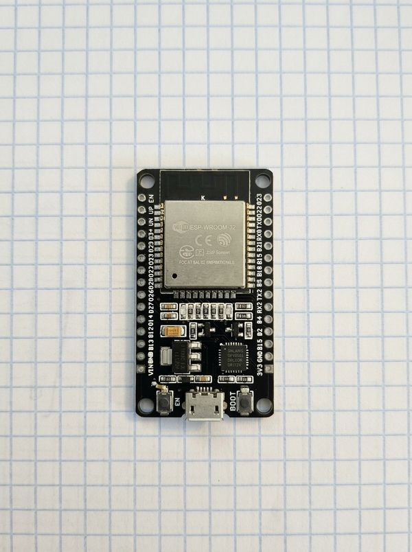

## ESP32-WROOM-32 DevKit

fauxcloud runs on a plain **ESP32 DevKit board** with the ESP32-WROOM-32 module. No soldering and no extra parts.

### What to buy

- A DevKit with the **ESP32-WROOM-32** module and **4 MB of flash**.
- A USB port on the board: it flashes the board and powers it.
- A USB data cable (not a charge-only one) and a USB power supply.
- A 2.4 GHz home Wi-Fi: the board has no 5 GHz radio.

Boards with extra memory (PSRAM) are not tested.

### Print a case

A two-part printed case for the DevKit, by [KRCreations](https://makerworld.com/en/@krcreations).

0.2 mm layers, two walls, 15 % infill, about 14 g of PLA.

[**Print the case**](https://makerworld.com/en/models/3640408-fauxcloud-esp32-weather-station-enclosure)

Whatever case you use, leave room over the board's two buttons: EN, the reset button, and BOOT. A case that presses EN holds the board in reset, so it stays dark. One that presses BOOT at power-up stops it from starting.

### The BOOT button

Hold it while fauxcloud is running:

| Hold | What happens |
|---|---|
| 1 to 3 seconds, then let go | fauxcloud restarts into setup and keeps your stations, settings and history. Use it after a new router or Wi-Fi password. |
| Less than 1 second, or 3 to 5 seconds | Nothing. |
| 5 seconds | **Erases everything**: Wi-Fi, passwords, Home Assistant settings, stations and their settings. Readings already in Home Assistant stay there. |

While you hold it, the board's LED (blue on the DevKit we verified) blinks once a second.

### The LED

| LED | Meaning |
|---|---|
| Dark | No power, or the board is held in reset or has hung. |
| A short flash every 6 seconds | All good. |
| Fast blinking, 4 times a second | Setup mode: join `fauxcloud-setup-XXXX`. Also while a firmware update is written. |
| Steady light | Listening to a new console (Settings, fauxcloud Wi-Fi for your station). Press Stop on that sheet to end it. |
| One short blink a second | Not connected to your home Wi-Fi. The console's Wi-Fi still works. Also in the first seconds after a start. |
| Three short blips, then a pause | Something needs a look: the MQTT broker (the server that passes messages to Home Assistant) is not reachable, the sign-in is locked after wrong passwords, or memory is low. |
| One blink a second while you hold BOOT | Counting the seconds you hold it. |
| Fast strobe, 10 times a second | From 4.5 seconds of holding BOOT: let go now to cancel. At 5 seconds everything is erased. |

### One console per board

One board serves **one console** (your weather station's display unit). fauxcloud keeps one station, its record of that console. A second console is turned away, and the dashboard says **A console was turned away: no free station place**. To switch consoles, forget the old station in **Settings** (the dashboard's **Admin** button, a padlock on a phone, opens it).

### What the board can hold

- **About 50 KB of working memory.** fauxcloud answers the console first and turns page requests away when memory is very low.
- **No encrypted dashboard.** The pages are plain HTTP on your home network: keep them off the internet. See [Security](../SECURITY.md).
- **280 KB of history:** over three months of hourly records and about two years of daily ones. The oldest go first.
- **Two firmware versions,** so a failed update goes back to the old one by itself.
