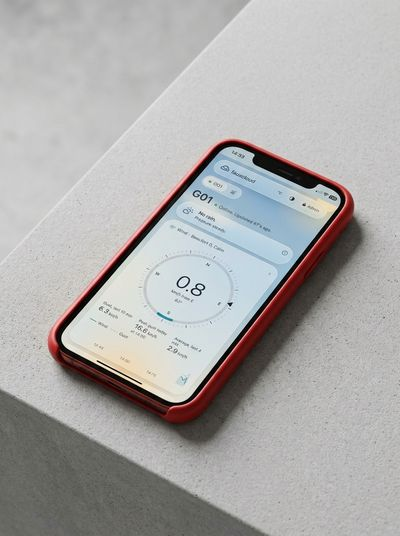

> [!TIP]
> You can try the dashboard and **Settings** with example data, without a board: [fauxcloud.org/try](https://fauxcloud.org/try/).

## Where it lives

")

Open `http://fauxcloud.local` from a device on your home network. If that name does not open on your device, use the board's IP address (for example `192.168.1.50`), which setup showed. It is also under **Details** in **Settings**.

- The page is not encrypted (plain HTTP). It works on your home network only, so keep it off the internet.
- You can change the name under **Name on your network** in **Settings**.
- To put it on your phone's home screen, see [On your phone](#on-your-phone).
- It works in Chrome or Edge 88 and later, and in Safari 14.5 and later on iPhone and iPad.

## On your phone

Add the dashboard to your phone's home screen, so it opens with one tap.

**iPhone**

1. Open `http://fauxcloud.local` in Safari, or the board's IP address (for example `192.168.1.50`).
2. Tap the **Share** button.
3. Tap **Add to Home Screen**, then **Add**.

   **You should see** the fauxcloud icon on your home screen.

**Android**

1. Open `http://fauxcloud.local` in Chrome, or the board's IP address (for example `192.168.1.50`).
2. Tap the three-dot menu **⋮**.
3. Tap **Add to Home screen** (newer versions of Chrome may call it **Install app** or **Create shortcut**), then confirm.

   **You should see** a fauxcloud shortcut on your home screen.

The shortcut opens the dashboard directly, full screen on iPhone. It reloads itself once when an update changes the dashboard. Like the dashboard itself, it works only on your home network: away from home it does not open.

## The tiles

A tile is one box on the dashboard. Each tile shows the latest reading from your console (your weather station's display unit). In fauxcloud, a station is the record it keeps for one console.

| Tile | What it shows |
|---|---|
| **Wind** | A dial with the direction and speed, the gust, **Peak gust today**, **Gust, last 10 min** and averages over the last few minutes and the last hour. |
| **Temperature** | The value, today's lowest and highest, the dew point and a "feels like" value. |
| **Rain** | The rate and the rain of the last hour, then **Rain today**. |
| **Humidity** | The value and today's range. |
| **Pressure** | The value and a trend arrow. |
| **UV and sun** | The UV index and the solar radiation in W/m². |

An **Indoor** tile appears only if your console sends indoor values. The verified console does not.

Tap a tile to open its sheet, a panel with that tile's history:

- Choose **Now**, **Today**, **Yesterday** or the calendar button for a **Date range**, with presets from 7 days to **All**.
- **Show table** lists every value. **Export CSV** saves the range on screen as a file.
- The wind sheet has a wind rose and Beaufort bands.
- Hourly records reach back over three months and daily records about two years. They are kept on the board through restarts and firmware updates. When the store is full, the oldest records go first.

Readings that cannot be real, such as wind above 195 km/h, are dropped before they reach the page. The sheets count them as rejected.

## Outlook and airport weather

Under the tiles, the **Outlook** card shows the Local outlook: a short line from your own station's readings. It covers rain now, calm, how the pressure is moving, and warnings for ice, strong gusts and frost. **Why this outlook** explains it. It is not a forecast. See [Local outlook](outlook.md).

If you turned on airport weather, a small plane button, **Airport weather**, sits at the end of the row of station names. It opens the airport view: reports from nearby airports, for reference, never mixed with your readings. See [Airport weather](airport-weather.md).

## Theme, units and language

The buttons at the top right:

- **EN** or **PL** switches between English and Polish. Before your first tap the page follows your browser's language. Setup is English only.
- **°C** or **°F** switches between metric and imperial. This changes the display only.
- The round, half-filled button switches between the light and the dark theme.

## Notices

When a part stops reporting, fauxcloud names the part in a small label (chip) under the top bar. Tap or hover a chip for the full sentence. It cannot fix hardware, but it tells you where to look.

| Notice | What to do |
|---|---|
| **Offline since 14:05** | The console sends nothing. On batteries or during a power cut this is expected; readings resume on their own. Check the adapter and Wi-Fi. |
| **Sensor not updating** | The outdoor sensor has not changed. A calm night can do this; a long gap means its battery or radio. |
| **Sensor missing** | Check the sensor's batteries. Taking the console's batteries out for a moment helps it find the sensor. |
| **Battery low** | The console reports a low battery. |
| **Pressure at factory value** | Set REL (the console's relative pressure setting, set to sea-level pressure) once in the console's SET menu. |
| **Pressure looks off** | Set REL in the console's SET menu to the current sea-level pressure of a nearby official station. |
| **Key changed** | Another key arrived for this station. If you re-paired the console, accept it in **Settings**. |
| **Console clock off** | Switch the console's time server (NTP) off and on in its SET menu. |
| **Time approximate**, **Waiting for time** | Sign in to **Settings** once on your phone, or connect fauxcloud to the internet. |
| **Clock behind** | History is paused until the clock is confirmed. The pause lasts 24 hours at most. |
| **Low memory** | Readings still arrive. If it stays, restart fauxcloud in **Settings**. |
| **History not saved** | Readings still arrive. If it stays, restart fauxcloud in **Settings**. If it says it needs one USB flash, see [Flash the board](flash.md#if-the-history-is-not-saved). |
| **Restarted** | fauxcloud restarted itself to free memory. Nothing to do. |
| **Profile changed** | The station's **Console model** setting changed: you changed it, or a new console's first upload did not look like the verified console. Nothing to do. |

Chips about fauxcloud itself:

- **Home Wi-Fi not joined**: fauxcloud is not on your home network. The console's Wi-Fi still works.
- **MQTT disconnected**: the broker is not reachable. MQTT is a small message system Home Assistant uses; the broker is the server that passes its messages. See [Home Assistant](home-assistant.md).
- **A console was turned away: no free station place**: one board keeps one console. To take a new console, forget the old station in **Settings**.
- **Upload too long, ignored**: a console upload was longer than fauxcloud accepts.
- **No answer from fauxcloud**: the dashboard lost contact with the board, not with the sensor.

The small icons in the status row show the clock, MQTT, memory and the Wi-Fi signal. Hover one for its state.

## Settings

The **Admin** button at the top right (a padlock on a phone) opens **Settings**, at `http://fauxcloud.local/admin`. It opens only from your home network. You sign in with the admin password you set in setup.

**Settings** holds:

- your stations: name, filters, calibration and the **Console** tab
- MQTT for Home Assistant
- online services
- airport weather
- **fauxcloud Wi-Fi for your station**
- your home Wi-Fi
- location and time
- the password and signed-in devices
- **Maintenance**: updates, restart and reset

> [!TIP]
> If you forget the admin password, hold the board's BOOT button for 5 seconds: that erases everything and runs setup again. See [Boards](boards.md#the-boot-button).
