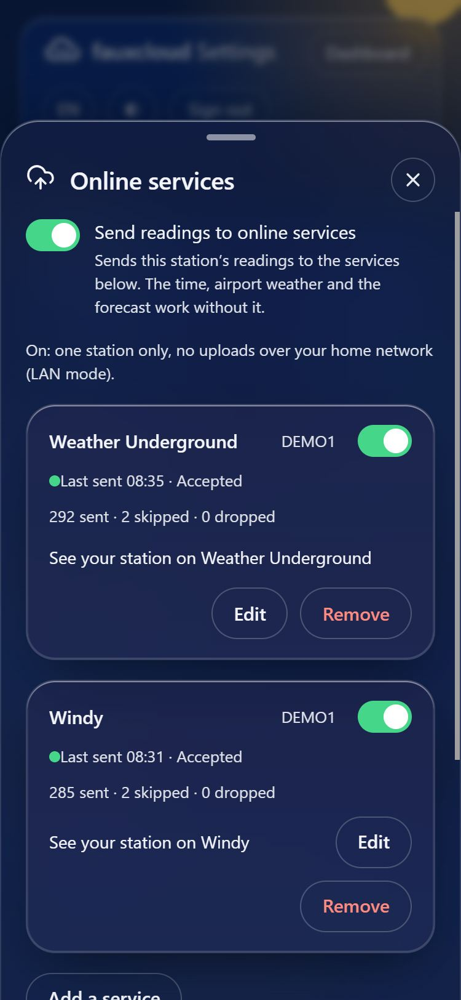

## What it does

Your console (your weather station's display unit) talks only to fauxcloud. With **online services** on, fauxcloud also sends each new reading to the services you choose, so your station can appear on their public pages and maps.

It works with:

- Weather Underground
- Windy
- WOW-BE, at wow.meteo.be, the successor of Met Office WOW
- PWSweather
- any server that understands the Weather Underground upload format
- your own URL, built from a template

fauxcloud is not affiliated with any of these services. The names are used only to say what it works with.

> [!NOTE]
> **Off until you turn it on**
> Nothing is sent anywhere until you add a service, check it with **Send one now**, and switch it on.

## What leaves your home

When a service is on, fauxcloud sends it:

- the station's outdoor readings: temperature, dew point, humidity, pressure, wind speed, gust and direction, rain, UV and solar radiation, when the console reports them;
- the time of the reading;
- the **Station ID** and the **Key or password** you entered for that service;
- the name `fauxcloud` as the software that sent it.

It does not send your location. The service shows the location you entered when you registered the station, so enter a rounded one there. Each service shows your readings on a public page and may reuse them under its own terms.

fauxcloud sends only a fresh reading. It sends only while the console is online, its outdoor sensor is updating and the board knows the real time. Otherwise it skips that send.

> [!NOTE]
> **The key travels to that service**
> The key goes to the service with every reading. With **Encrypted (HTTPS)** on, nobody on the way can read it. With it off, anyone between your board and the service can. Once saved, fauxcloud never shows a key again; to change it, type a new one.

## Set up a service



1. Open **Settings** (the **Admin** button on the dashboard, a padlock on a phone, or `http://fauxcloud.local/admin`) and sign in.
2. Under **Home Assistant and online services**, open **Online services**.
3. Choose **Add a service** and pick the service.
4. Enter the **Station ID** and the **Key or password** you copied from the service's own page.
5. Press **Save**, then **Send one now**.

   **You should see** "Accepted". Other answers are "Key refused", "Server not reachable", "Certificate not trusted" and "Not sent: no fresh reading".

6. Switch the service on with the switch beside its name, for example **Windy on**. It turns on only after a **Send one now** was accepted. Changing the ID or key switches a service off again until you check it.

You can add up to three services. The sheet also shows when the last send happened and how many were sent, skipped and dropped.

> [!WARNING]
> **One station, no uploads over your home network**
> With online services on, fauxcloud keeps one station only (a station is fauxcloud's record of a console). It also stops accepting uploads over your home network (LAN mode: a console that sends through your router), so the console must be on the fauxcloud Wi-Fi. The sheet says this before you confirm.

### What to copy from each service

- **Weather Underground:** the Station ID and the Station Key, from [wunderground.com](https://www.wunderground.com) under My devices. Check the elevation the service shows; it is public.
- **Windy:** on [stations.windy.com](https://stations.windy.com) open your station and copy the Station id and the Station password from its Connection box. Not an account API key.
- **WOW-BE:** on [wow.meteo.be](https://wow.meteo.be) copy the 8-character Short ID from your site's page, not the long page id, and the password you chose. Set your own time zone there; it starts on Brussels.
- **PWSweather:** on [pwsweather.com](https://www.pwsweather.com) copy the Station ID and the 32-character API key from the station page, not your account password. Choose Precision: Neighborhood for the location.

### Weather Underground-compatible server and your own URL

**WU-compatible server** takes a **Server** name and a **Path** (the default is `/weatherstation/updateweatherstation.php`) and sends the same upload as the Weather Underground target. **Answer that means "accepted"** is optional: the text the server's reply contains when it accepts an upload.

**Custom service** takes a **URL template**. fauxcloud fills in the values in curly braces and sends the result as a GET request:

```text title="A URL template"
https://example.org/up?t={temp_c}&id={id}&k={key}
```

A parameter whose value is missing is left out. A template cannot contain a `#`, spaces or a `user:password@` part. Variables you can use:

| Group | Variables |
|---|---|
| Identity | `id`, `key`, `softwaretype` |
| Time | `dateutc`, `dateutc_iso`, `dateutc_compact`, `epoch`, `date_local`, `time_local` |
| Metric | `temp_c`, `dewpt_c`, `humidity`, `pressure_hpa`, `wind_kmh`, `gust_kmh`, `wind_ms`, `gust_ms`, `winddir`, `rain_1h_mm`, `rain_daily_mm`, `rain_rate_mmh`, `UV`, `solarradiation` |
| Wind averages | `wind_avg2m_ms`, `wind_avg10m_ms`, `gust_10m_ms`, `wind_mean_ms`, `gust_max_ms`, `wind_mean_kn`, `gust_max_kn`, `windmean_mph`, `gustmax_mph` |
| Weather Underground names | `tempf`, `dewptf`, `baromin`, `windspeedmph`, `windgustmph`, `windspdmph_avg2m`, `winddir_avg2m`, `windgustmph_10m`, `rainin`, `dailyrainin`, `rainratein` |

Names are case-sensitive. An unknown variable is refused when you save.

## Weather Underground and the console's own upload

The console can upload to Weather Underground itself. At the time of writing, Weather Underground does not accept an upload without the parameter `action=updateraw`, and the console never sends it.

fauxcloud's Weather Underground target sends a complete upload that includes `action=updateraw`, with the Station ID, Station Key, the time and the readings. This was tested by replaying the console's own request against the service, not on the console. The result depends on what the service accepts on the day.

## How often

fauxcloud sends every 5 minutes. Windy and PWSweather take one reading per 5 minutes at most, so fauxcloud sends to them every 5 minutes and 10 seconds. The interval is fixed; there is no setting for it.

Sends happen one at a time and never delay the console's own upload. If memory is short or fauxcloud is busy, it skips that send and tries at the next one.

## Encrypted sending (HTTPS)

**Encrypted (HTTPS)** is on for a new service. Turn it off only if a service needs plain HTTP.

- fauxcloud checks the service's certificate against root certificates built into the firmware. If the certificate does not trace back to one of them, the send fails with "Certificate not trusted". For a preset, update fauxcloud (install a newer firmware version). For a custom server, turn **Encrypted (HTTPS)** off; the key then travels unencrypted on the way out.
- fauxcloud needs the real time to check a certificate.
- Each encrypted send takes about 17 KB of the board's memory for a moment. If memory is short, the send is skipped, and after repeated shortages the service is paused with a message that says so.
- A **Custom service** takes the encryption from its URL: `https://` is encrypted, `http://` is not.

## Weather Underground forecast

fauxcloud can also show Weather Underground's forecast for tomorrow beside your outlook, labelled as Weather Underground's. It is separate from sending your readings. It is off until you turn it on.

1. Get an API key from Weather Underground. It is under API keys on wunderground.com, and is free for stations that upload to it. It is not the Station Key.
2. In **Settings → Online services**, find **Forecast** and open **Weather Underground forecast**.
3. Under **API key**, type the key (32 letters and digits), then save.
4. Press **Fetch now** to check the key.

   **You should see** "Fetched ..." followed by a line such as "Tomorrow: ...".

5. Switch on **Show WU's forecast on the dashboard**.

It needs this station's location (**Settings → Location and time**).

- fauxcloud asks Weather Underground once an hour.
- It sends the location rounded to one decimal, about 11 km.
- The forecast line gives Weather Underground's words for tomorrow, with the high and low, marked "WU".
- The line is on the second page of the **Outlook** card under the tiles. The dots on the card switch between its pages.
- From midnight to 03:00 it shows today instead.

The forecast is not published to Home Assistant. See [Local outlook](outlook.md) for how it sits beside the outlook.

## If a send fails

The sheet says what happened in plain words:

| Message | What to do |
|---|---|
| Accepted | Nothing. |
| Key refused | Open **Edit** and check the Station ID and key. Three refusals in a row pause the service. |
| Server not reachable | Check your internet; fauxcloud tries again at the next send. |
| Certificate not trusted | Update fauxcloud, or for a custom server use plain HTTP (the key then travels unencrypted). |
| Too soon | The service takes one reading per 5 minutes; wait. |
| Not sent: no fresh reading | The console has not uploaded recently. See [Troubleshooting](troubleshooting.md). |
| Not sent: not enough memory for an encrypted send | Try again later, or turn off **Encrypted (HTTPS)** for that service. |

Verified on one console and one board. A service can change its rules at any time.
