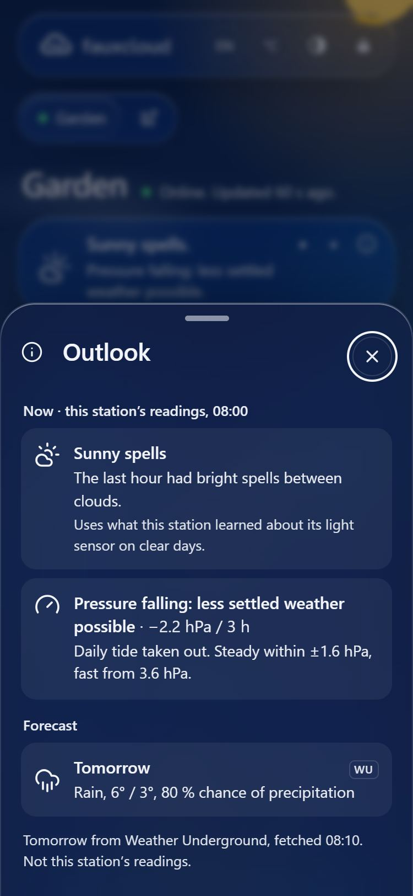

## What it is

Under the tiles on the dashboard there is a short outlook, for example "No rain. Pressure steady." It is made from what your station measures: the rain gauge, the temperature and dew point, the wind, the sun sensor and above all the pressure.

It describes the weather now and gives a hint of what is next. It reaches a few hours ahead at most, and only through the pressure trend and the night's cooling. It is not a forecast from a weather model, and it is wrong sometimes. For a forecast, see the [airport forecast](airport-weather.md) and the [Weather Underground forecast line](online-services.md#weather-underground-forecast).

Tap the ⓘ next to it to see what each line is based on. The same words are published to Home Assistant as one text entity called **Local outlook**; see [Home Assistant](home-assistant.md).

## What it can say

The outlook has up to four parts: what it is like now, one extra word, what comes next and one warning at most.

| It says | When |
|---|---|
| No rain. | No rain falling now, and the air is above 2 °C. At or below 2 °C the unheated rain gauge may not see snow or sleet, so it stays silent. |
| Light rain. Moderate rain. Heavy rain. | Rain falling now: light below 2.5 mm per hour, heavy above 7.6 mm per hour. |
| Sleet or snow. | Rain at 1 °C or below. |
| Recent rain. | The gauge measured rain in this hour or the one before; none is falling now. |
| Clear night. | At night, when the air cooled by more than 1 °C within an hour in light wind (under 5 km/h), and has not warmed since. |
| Sunny. Sunny spells. No sun. | By day, once fauxcloud has learned this station's clear-sky level (below). |
| Severe frost. | Extra word: 10 °C below zero or colder. |
| Freezing. | Extra word: 0 °C or colder. |
| Hot. | Extra word: 30 °C or warmer. |
| Windy. | Extra word: mean wind of the last hour from 20 km/h. |
| Humid. | Extra word: humidity from 90 % by day. |
| Calm. | Extra word: a calm hour. |
| Pressure steady. Pressure rising. Pressure falling: less settled weather possible. | The change over the last 3 hours: steady within 1.6 hPa, rising or falling beyond it, "fast" from 3.6 hPa. The normal daily rise and fall of pressure is removed when the station has a location. |
| Pressure steady, cooling fast. | Steady pressure at night while the temperature fell fast. |
| Minimum around ... tonight. | A learned estimate of tonight's lowest temperature on a clear night (below). |
| Icy surfaces possible. | At or below 1 °C with rain now or in the last 12 hours. |
| Gusts to ... | The strongest gust of the last 10 minutes is 30 km/h or more. |
| Ground frost possible. | A clear, calm night with the air at or below 2 °C, since the grass is about 2 °C colder. |
| Hoar frost likely on cold surfaces. | A clear, calm night with the dew point within 2 °C of the air temperature and the air at or below freezing. |
| Mist or fog possible. | Humidity is close to what this sensor shows in saturated air, with light wind and no rain (the saturation level is learned, see below). |

When the main airport is within 60 km and has a current report, one more kind of line can appear, worded "Rain reported nearby." (also snow, drizzle, thunder, fog and mist). It names its source in the ⓘ. Your own readings always come first, and a line from the airport only takes a slot your station left free.

The sensor can read high in direct sun with light wind, and the page says so when it says "Hot."

### When it stays quiet

- **No clock yet.** The outlook needs the real time. Until fauxcloud has it, the Home Assistant entity says "Outlook waits for a valid clock."
- **Collecting pressure.** The pressure line needs four hourly averages in a row. After a start it says "Pressure outlook in N h."
- **Paused.** If the pressure calibration or the clock was in doubt during one of the last hours, there is no trend; the ⓘ says "Pressure outlook paused (calibration or clock)."
- **Outdoor sensor not updating.** Only the pressure line is shown, because the barometer in the console (your weather station's display unit) still reports.
- **No pressure at all.** If the station has never sent pressure, there is no outlook.

## What the learners do

fauxcloud also learns this station's own normal ranges, over days and weeks. Each learner starts from standard rules and takes over only once it has seen enough. Until then the standard rules apply, and the outlook works from the first hours.

| What it learns | What it looks like | What it changes |
|---|---|---|
| **Clear-sky level** | How bright the light sensor reads on a clear day, for each height of the sun | "Sunny.", "Sunny spells." and "No sun." |
| **Shade around the sensor** | A map of the sky: patches where the sun reached the sensor, patches where a tree or a building blocked it | Information only |
| **Humidity at saturation** | What the humidity sensor reads when the air is full of water | "Mist or fog possible." |
| **Smallest wind reported** | The console reports wind in steps; this is its smallest reading above zero | Information only |
| **Usual wind here** | The wind most hours stay under, and the wind only one hour in ten beats | Information only |
| **Evening cooling** | How fast clear evenings cool here, compared with cloudy ones | What counts as "Clear night." |
| **Night frost** | How far the air here cools on a clear, calm night | "Minimum around ... tonight." |
| **Pressure check** | Your console's pressure against long-term normals for your area | A notice when the pressure looks off |

The pressure check works with no internet, from normals stored in the firmware. It is silent when airport weather is on (that comparison is used instead; see [Airport weather](airport-weather.md)), when the console's pressure is at its factory value, and when the station has no location.

### How long it takes

A learner is used by the outlook only once it has enough samples:

- **Clear-sky level:** 12 clear-sky hours at a given sun height. Bright haze does not count. Heights fill in as the sun climbs through the year.
- **Humidity at saturation:** about 24 clear nights.
- **Evening cooling:** 18 clear and 18 cloudy evenings. It usually waits for spring, when the clear-sky level at evening sun heights is known.
- **Night frost:** 78 clear, calm nights, with its guesses within 2.0 °C. This one can take months.
- **Pressure check:** a first check after 14 days, a finer one after 51 days.

Learning needs the station's location (**Settings → Location and time**). Without it, it is paused.

### The Learning sheet

In **Settings → Stations**, the **Learning** tile opens the **Learning** sheet for a station. For each part it shows:

- its value: "Measured ..." once learned, or "Default ... (not yet learned)" before
- a meter with three bars
- how much is left, such as "Still learning: about N more clear-sky hours", until it is ready
- "In use." when the outlook reads it

The sky map shows the shade around the sensor.

The sheet warns when something looks wrong with the sensor, for example "Light sensor looks covered", "Temperature not changing" or "Sunlight reported at night". **Restart learning** is for when you moved or replaced the sensor: learning restarts from what it knows, and the outlook uses the standard rules until each part is learned again.

The **Weather description** tile beside it shows, per station, the rules and thresholds behind each outlook line.

## How it sits with the forecasts

- The **airport forecast** (TAF) is the airport's own forecast for the next 12 hours. It never changes the outlook's rules; it appears on the second page of the **Outlook** card on the dashboard, tagged with the airport's code.
- The **Weather Underground forecast** is Weather Underground's words for tomorrow, fetched once an hour, tagged "WU".
- The **Local outlook** is neither of those: it is your own station's readings and nothing else, apart from a "reported nearby" line from the main airport when it is close.

## Limits

- The rain gauge counts about 0.2 mm per tip of its bucket, so drizzle and the start of a shower may not show.
- Snow does not tip the bucket, so the outlook does not say "No rain" when it is cold.
- Verified on one console.
