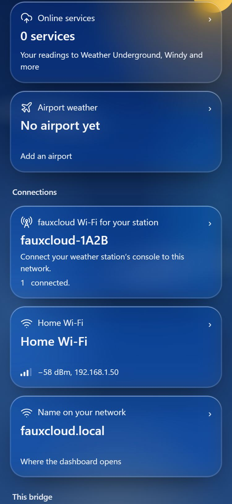
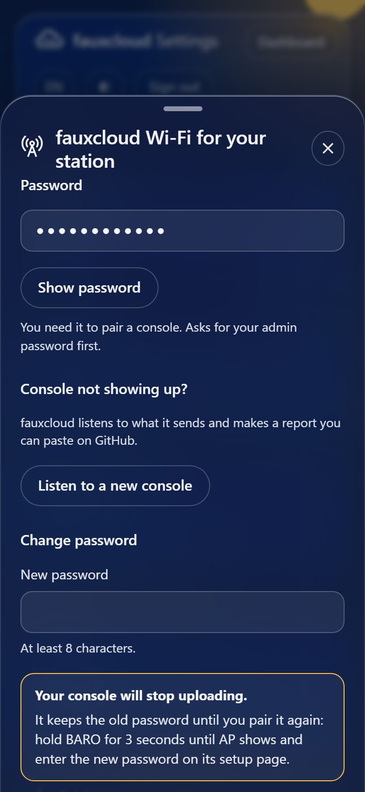
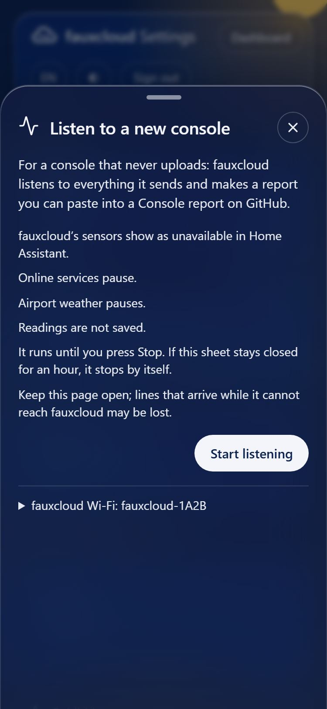

fauxcloud is verified on one console. Your report is how a second one gets checked. The **Listen to a new console** sheet records what your console sends and turns it into text you can paste.

Listening needs fauxcloud 1.1 or later. **Settings**, then **Maintenance** shows your version and installs updates.

## What you need

- A computer on your home network, to keep fauxcloud's sheet open while it listens.
- Your console, and a phone to open its setup page. The console's manual says how. On the verified console (the Vevor 7-in-1) you hold the **BARO** button for 3 seconds until **AP** (access point) shows on its screen.
- A free GitHub account, to send the report.
- About fifteen minutes.

> [!WARNING]
> **While it listens, fauxcloud pauses its normal work**
> Home Assistant shows fauxcloud's sensors as unavailable, online services and airport weather pause, and readings are not saved. Your console has no internet on fauxcloud's Wi-Fi, so its own cloud or app shows nothing either. All of this comes back when you press **Stop**, after a restart, or by itself after an hour with no page open on the sheet.

> [!NOTE]
> **Does your console upload already?**
> Then you do not need to listen. In Settings, open the station, then its **Console** tab, and copy the last lines into the [console report](https://github.com/fauxcloud/fauxcloud/issues/new?template=console_report.yml). The console's name and key are hidden there already.

## 1. On the computer: start listening

1. Open fauxcloud's **Settings** (the **Admin** button on the dashboard).
2. Open **fauxcloud Wi-Fi for your station**, then, under **Console not showing up?**, **Listen to a new console**.
3. Press **Start listening**. The small LED on the ESP32 board stays lit while it listens.

Keep this sheet open on the computer until step 3 is done.

## 2. Pair the console with fauxcloud's Wi-Fi

Your phone leaves your home Wi-Fi for a moment to join the console's own setup network; listening keeps going on the computer meanwhile.

> [!TIP]
> **Not sure of the name or the password?**
> On the computer, open the line **fauxcloud Wi-Fi: fauxcloud-…** on the sheet, below the report. It shows the network's name and password (**Show password** asks for your admin password first).

1. With the phone, open the console's setup page, as its manual says.
2. Pick fauxcloud's Wi-Fi network (`fauxcloud-…`) and enter its password.
3. Fill in the upload boxes the page has (a station ID and key, or a server address) with made-up values, never your real ones: any ID and key will do. fauxcloud hides the values it recognises as IDs, keys and passwords, but it cannot know every field name.
4. Save the settings on the console.

Only the console goes on fauxcloud's Wi-Fi. Every other device there adds its own lines and fills the report.

## 3. Wait for the console's requests

1. Watch the report on the computer. A line starting `HTTP:` is an upload attempt; a console often tries about once a minute.
2. After two or three tries, or a few minutes with no new lines, press **Stop**.
3. Press **Copy**. **Download** saves the same text as a file.

")

You do not need to understand the report. If the sheet lost touch with fauxcloud for a while, it says how many entries were not kept. If it says it stopped before the console tried, press **Listen again**, then **Start listening**.

## 4. Send the report

1. Read the report and delete anything that is yours. fauxcloud hides IDs, keys, passwords and all but the maker's part of each device's MAC address, but it cannot know every field name.
2. Open the [console report](https://github.com/fauxcloud/fauxcloud/issues/new?template=console_report.yml) form on GitHub, answer the few questions about the console and paste the report.
3. Add two photos if you can: the label on the back of the console (cover the numbers printed there), and its setup page (cover your Wi-Fi name and password).

Never send passwords, keys, the crash file (a diagnostics file from Maintenance that holds your passwords) or the exact location of your weather station.

## When you are done

The console still uses fauxcloud's Wi-Fi. If you want it back as it was, open its setup page again and enter your home Wi-Fi and its cloud settings, as its manual says.

Reports are read in batches, roughly once a week, and no response time is promised; we may ask you for more. A model is listed as working only after a report from a real console. If you tick the box in the form, your GitHub handle is credited on the [Compatibility](station-profiles.md) page.
