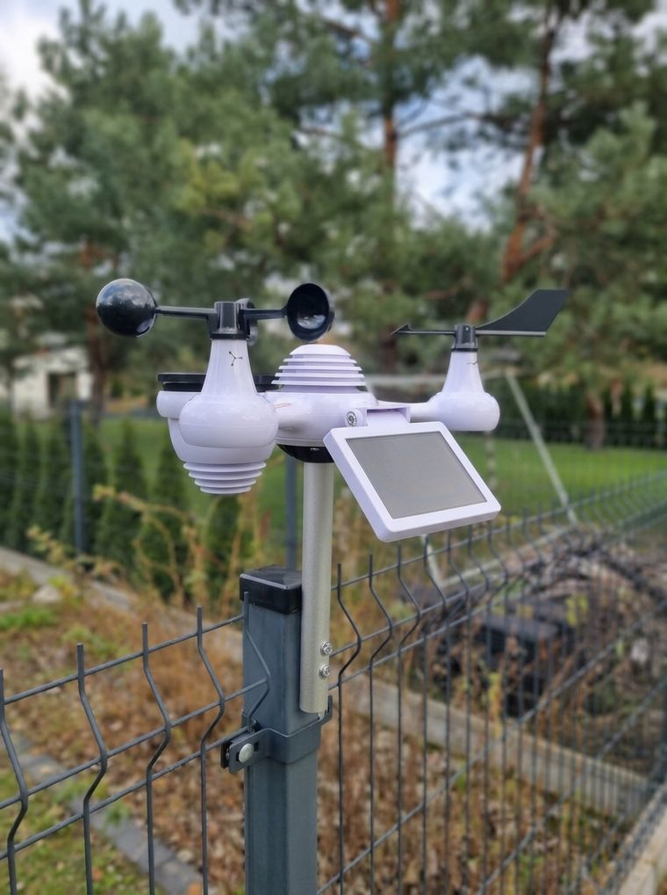

# Compatibility

What fauxcloud knows about each console (your weather station's display unit) it works with, and how sure it is. One section per console model.

How to read the words used here:

- **Verified on one unit**: checked on a real console of this model, with a log of what it sent. One unit and one firmware version, not a guarantee for every unit sold under that name.
- **Reported by other users**: written down by people who run other bridges for the same console. fauxcloud has not seen it happen.
- **Not verified**: nobody has seen it on a real console yet. fauxcloud handles it as described, and says what to watch.

In the tables, **verified**, **reported** and **not verified** mean these three.

fauxcloud is independent software. It is not made, endorsed or supported by the makers or sellers of the consoles listed here, or by the online services it can send to. Names appear only to say what works with what.

## Vevor / SucceBuy 7-in-1 weather station, model YT60234

The 7-in-1 outdoor sensor (868 MHz in the EU) with a 7.5 inch Wi-Fi colour display. Sold under more than one name; the SucceBuy version is reported to be the same unit, but that is not verified.

**Verified on:** one console, display firmware 1.0.1, EU 868 MHz, checked in November 2026. Nothing below is claimed for another firmware version.

### What fauxcloud does with this console

- The console joins fauxcloud's own Wi-Fi network. fauxcloud answers its name lookups with its own address, so the console's upload to Weather Underground arrives at fauxcloud instead of the cloud.
- fauxcloud replies `success`, converts the readings to metric and shows them on the dashboard and, if you use it, in Home Assistant.
- It also answers the console's time requests (see [Time and the clock](#time-and-the-clock)).
- It answers the console's Weathercloud upload with a plain `200`, does not read it and does not forward it. Nothing from Weathercloud is used.
- It drops readings that cannot be real and counts them instead of showing them: wind above 195 km/h (121 mph), humidity under 3 %, garbled numbers.

### What is verified on one unit

What the upload contains, and what else the console sends. The network, upload and time findings are under [Setup findings](#setup-findings).

| What | Status | Note |
|---|---|---|
| Fields sent | verified | Exactly these fourteen, in this order, in every upload: `ID`, `PASSWORD`, `dateutc`, `baromin`, `tempf`, `humidity`, `dewptf`, `rainin`, `dailyrainin`, `winddir`, `windspeedmph`, `windgustmph`, `UV`, `solarRadiation`. |
| Never sent | verified | Indoor temperature and humidity, absolute pressure, weekly / monthly / yearly rain. They stay on the console's screen. |
| Names the console asks for | verified | Only the time server (NTP: the service a device asks for the current time), the Weather Underground upload server and, if you tick it, the Weathercloud server. No other traffic was seen in about 15 hours. |
| Open ports | verified | The console has no open port while it is joined to a network as a normal Wi-Fi client. |
| Rain counting | verified | `rainin` is a rain rate, not Weather Underground's last-hour total: the rain of the last ten minutes times six. One tip of the bucket is about 0.225 mm. Measured by counting tips against the display, not in real rain. |
| Pressure | verified | `baromin` is REL (the console's relative pressure setting, the value you calibrated to sea-level pressure), in steps of 0.01 inHg (about 0.34 hPa). The factory value is 29.92 inHg = 1013.2 hPa. |
| Display units do not change the upload | verified | Weather Underground fields are always imperial. Weathercloud values are always metric. |
| Solar | verified | `solarRadiation` is the display's lux reading divided by about 126.7. Checked up to about 167 W/m². |
| Wind | verified | `windspeedmph` is the latest sample. `windgustmph` is the highest value over a short window. `winddir` has 1 degree resolution. |
| Lost outdoor sensor | verified | The console keeps uploading the last values unchanged, with no marker. fauxcloud notices and shows "Sensor not updating". |

**Rain counting.** The rate holds for about ten minutes after the last tip. `dailyrainin` restarts at the console's local midnight. Real rain is not verified yet: see [What is not verified](#what-is-not-verified-and-what-to-watch).

**Pressure.** What resets REL to the factory value is under [Known quirks](#known-quirks-and-the-fix).

### Setup findings

#### Pairing and setup

| What | Status | Note |
|---|---|---|
| Pairing flow | verified | Hold the BARO button for more than 3 seconds. The display shows `AP` and the console opens its own setup Wi-Fi (AP): a network named `WWS-` plus six characters. Its setup page is at `http://192.168.1.1`. |

**Pairing flow.** Join the `WWS-` network and open `http://192.168.1.1`. Enter fauxcloud's Wi-Fi name and password, tick the Weather Underground box, and type any station ID and key. The ID becomes the station's name in fauxcloud (the station is fauxcloud's record of this console). Holding BARO for more than 3 seconds again leaves AP mode without changes. A phone worked on day one, a laptop on day two (see the one-device quirk under [Known quirks](#known-quirks-and-the-fix)).

#### Network and DNS

| What | Status | Note |
|---|---|---|
| Why fauxcloud's network is 192.168.77.x | verified | The console's own setup network uses 192.168.1.x. Other users report address clashes when a home router is also 192.168.1.1. fauxcloud uses 192.168.77.1 to stay clear. A home network that is itself 192.168.77.x will clash with it. |
| DNS comes from DHCP | verified | The console uses the DNS server in its DHCP offer. fauxcloud hands out itself, so fauxcloud's own Wi-Fi works without changing anything on your router. |
| LAN-mode alternative | reported | The console stays on your home network, and a router DNS override points the Weather Underground name at fauxcloud. Router-DNS bridges are reported to work on this model. Not tested here as a long run. |

**LAN mode.** This needs the **Accept uploads from my home network** switch, and one console per network.

#### The upload

| What | Status | Note |
|---|---|---|
| The upload | verified | A plain HTTP GET on port 80 to `/weatherstation/updateweatherstation.php`, with no encryption and a new connection for every upload. It comes about every 65 seconds (692 uploads in a row overnight). |
| What the console expects back | verified | HTTP 200 with the body `success`, sent in one network segment. fauxcloud replies in one piece. |
| Weathercloud, when ticked | verified | The console contacts only `api.weathercloud.net` (not `.online`, which one other user reported): plain HTTP, path style, three times per cycle, values in metric. Without the tick it sends nothing to Weathercloud. |

**The upload.** The 14 fields are listed under [What is verified on one unit](#what-is-verified-on-one-unit). Other users report about 60 s, and 30 s on a sibling model. The `dateutc` fields are not zero-padded, for example `18%3A50%3A3`, so fauxcloud accepts one- and two-digit fields.

**What the console expects back.** If the reply is split, the console treats the upload as failed. It waits about 6 seconds and sends the same GET again, up to three per cycle.

**Weathercloud.** When it is ticked, the Weather Underground upload is sometimes repeated 2 to 4 times in a cycle.

#### Time and the clock

| What | Status | Note |
|---|---|---|
| Without internet or a time server | verified | Uploads work on a network with no internet at all. The console asks for the time by name (one of four fixed hosts, `time.windows.com` by default), and fauxcloud answers from a real time source. |
| The display's clock | verified | With the console's time server switched on, `dateutc` is real UTC. With it off, `dateutc` is the hand-set clock minus the zone. To fix a wrong console clock, switch the time server off and on. |

**Without internet.** A console whose clock was lost (batteries out) sends nothing at all until one time request is answered. The first answer releases it within about 3 seconds. If fauxcloud has no real time source yet, such a console stays silent.

**The display's clock.** The console asks the time server when it powers up with a lost clock, about every 100 minutes, and after local midnight. It accepts an answer only after a cold start or after you switch the time server off and on. It ignores the later answers, so fauxcloud does not rely on them.

#### Power and outages

| What | Status | Note |
|---|---|---|
| The setup page only works while the console is on its power adapter | verified | On batteries the console switches its Wi-Fi off, so it uploads nothing. Batteries keep the display, the clock and the sensor link. A "fauxcloud: offline since ..." after a power cut is expected, not a fault. |
| First upload after power-on | verified | About 11 to 12 seconds after joining. After an adapter power cycle with the batteries in, the console asks for no time and uploads straight away. |
| When fauxcloud is down and comes back | not verified | Not tested as a deliberate outage. Known: the console re-joins seconds after the adapter or the network is back, and a missed reply is repeated after about 6 seconds (see [The upload](#the-upload)). |

**When fauxcloud is down.** History is not backfilled: a gap stays a gap.

#### Identity: keys and IDs

| What | Status | Note |
|---|---|---|
| First key wins | not verified | The first console to use a station ID binds its key. A different key for the same ID shows "Key changed" and waits for you to accept it. Checked in fauxcloud's own tests; not specific to this console. |
| A new ID on the same console | not verified | If you type a new ID into the console's setup page, fauxcloud recognises the console by its hardware address (MAC address). It offers to carry the old history and settings over. Built, not yet checked on a real change. |

#### Firmware and other batches

| What | Status | Note |
|---|---|---|
| Firmware and batch seen | verified | Display firmware 1.0.1; its Wi-Fi chip is from Bouffalo Lab. One unit, one batch. |

**What we rely on that another batch may change.** Plain HTTP with no encryption (some newer similar consoles are reported to be HTTPS-only), the host names `rtupdate.wunderground.com`, `time.windows.com` and `api.weathercloud.net`, the reply being read from the first segment only, the 14-field order, and the DHCP-supplied DNS. A batch that changes any of these may not work. Please report it.

### What is not verified, and what to watch

fauxcloud ships with these behaviours as they are. If you see one, tell us (see [Report a new console model](#report-a-new-console-model)).

| Behaviour | Status | What fauxcloud does | What to watch |
|---|---|---|---|
| **`lowbatt`** (low battery flag) | **Not verified on this unit yet.** Never sent in about 800 uploads. Whether the console ever sends it, and with what value, has not been seen. | Publishes a "battery low" sensor that turns on when `lowbatt` is `1`. | If your battery-low sensor never changes but the sensor's battery is weak, the console may use another value. Send us the raw line. |
| **The first real rain event** | **Not verified on this unit yet.** The rate and daily total were checked by counting bucket tips, not in real rain. Real rain has not yet been compared with a nearby official station. | Shows rate, last hour and today as the console reports them. | Compare the day's total with a nearby official station. Very light rain and drizzle may show nothing: the first tip needs about 0.2 mm. |
| **Solar / UV in full sun** | **Not verified on this unit yet.** Other users report that `solarRadiation` above about 367 W/m² wraps negative and arrives as text like `-117.-5`. This unit has only been read up to about 167 W/m². | Drops a value it cannot read, keeps the rest of the upload, and still answers `success`. | A solar tile that goes blank or odd in bright sun. |
| **Gusts** | **Not verified on this unit yet.** A gust above 99.9 km/h (62 mph) has never been seen. One test, blowing into the anemometer, showed 99.9 km/h on the display and the same value in mph in the upload. | Shows what the console sends. | Gusts that stop at 99.9 km/h in a real storm. |
| **`dateutc` in summer** | **Reported.** The console may leave out the daylight-saving hour, so `dateutc` can be an hour off between March and October. | Does not trust `dateutc` as the time of a reading. It uses its own clock. | Nothing on screen. This only matters if you read the raw line. |
| **Other firmware versions and batches** | **Not verified.** Only 1.0.1 was seen. Newer batches of similar consoles are reported to upload over HTTPS only, which fauxcloud cannot receive. | Nothing: it only answers plain HTTP. | A console that joins the Wi-Fi but never uploads. |
| **Upload to Weather Underground without fauxcloud** | **Not verified on the console.** Weather Underground now refuses uploads that lack `action=updateraw`, and this console never sends it. Found by live tests with a replayed request, not on the console itself. | The console talks to fauxcloud only. When you turn on forwarding, fauxcloud adds the missing parameter. | A forwarded station that Weather Underground does not show. Check the "Key refused" message in the forwarding sheet. |
| **Weathercloud** | **Not verified.** The request is known (see [The upload](#the-upload)). Linking a station on Weathercloud itself is not verified: one other user never got it linked. | Answers `200` only (see [What fauxcloud does](#what-fauxcloud-does-with-this-console)). | Weathercloud showing no data is expected. |

**The first real rain event.** Snow does not tip the bucket at all, and counts as rain when it melts.

**Gusts.** The 99.9 km/h in that test could be a clamp.

**Upload to Weather Underground without fauxcloud.** This is likely why the console cannot reach Weather Underground on its own today.

### Known quirks and the fix

- **The console's pressure resets to the factory value.** Verified: it happens when you change any display unit in the SET menu, step past item 15 of the SET menu, or take the batteries out so the console cold-starts. REL goes back to 1013.2 hPa (29.92 inHg) and every sea-level pressure from then on is wrong.
  - fauxcloud shows the notice **"Pressure at factory value"** and, when it has one, the last good value and how old it is.
  - Fix: set REL again in the console's SET menu. Look up the current sea-level pressure of a nearby official station or airport first. With airport weather on, fauxcloud suggests a value ("Pressure looks off").
- **A cold start loses more than pressure.** Taking the batteries out also resets the clock, the display language and the rain counters. fauxcloud's time answer brings the clock back; the rest you set again.
- **The setup page's Apply overwrites the time zone** you set in the console's menu. Check the zone again after using it.
- **The console's own setup network takes one device at a time** and sometimes drops it. A browser that remembered another device at `192.168.1.1` may show that device's page instead.
- **Fit the wind vane with its screw on the flat of the rod.** The tip toward the funnel is 0 degrees, and the funnel faces north. A vane seated off the flat read about 60 degrees off on the verified console.
- **Time zone and daylight saving are manual** in the console's menu. They change what the display shows, not the upload.
- **Humidity can read low in long fog or rain.** The humidity sensor is reported to be accurate only to about 2 %, so a low value is not necessarily a fault. A temperature stuck at 70 degrees with 1 % humidity is a failed sensor board (reported by other users; the board can be replaced).

### Not supported

- **YT60307** (the model that pairs through the SmartLife / Tuya app) does not upload to Weather Underground, so fauxcloud does not apply.
- Consoles that upload only over HTTPS.

## Other consoles

Consoles with the same setup page (a `WWS-` network, `http://192.168.1.1`, a Weather Underground box on the page) are reported by other users to be the same family. Some of them are sold under other brand names. **None of them has been tested with fauxcloud.** They are not listed as supported until someone sends a report.

## Report a new console model

A short report is enough. Please collect:

1. **Brand and model** as printed on the console and the box, and where you bought it.
2. **Firmware version**, shown on the console's setup page.
3. **Region and frequency** (868 or 915 MHz).
4. **A capture of what it sends:** open **Settings**, then the station, then its **Console** tab, and copy the last lines. The console's name and key are hidden there already. Please also say which unknown fields appear under **Extra sensors**.
5. **Photos:** the label on the back of the console (cover any MAC address or serial number on it), and the setup page after the console joined fauxcloud's network (you can hide your Wi-Fi name and password).
6. **What worked and what did not:** did it upload, which fields were missing, did the pressure read the factory value, did it need the power adapter, how often did it send.
7. **Anything odd:** a field with a strange value, a console that sends more than fourteen fields, or one that never uploads.

Never send passwords, keys, the crash file (it contains your passwords) or the exact location of your weather station.
